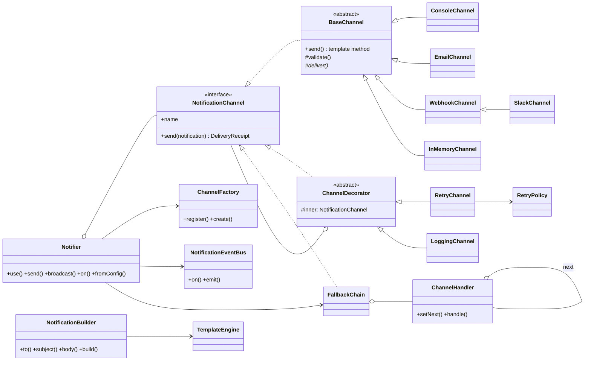

# notifykit

Biblioteca TypeScript para **envio de notificações multicanal** (Console, E-mail, Webhook, Slack...) com retry, fallback entre canais, templates e eventos. Ela foi feita para ser **estendida** com canais e comportamentos próprios, sem alterar o código da lib.

> Trabalho da disciplina de Design Patterns e Clean Code.

## Equipe

- **João Guilherme Marques**
- **Mateus Nathan**

## Vídeo de apresentação

▶️ **YouTube:** _[link do vídeo aqui](https://youtube.com/)_

---

## Sumário

1. [Problema que a biblioteca resolve](#problema-que-a-biblioteca-resolve)
2. [Instalação](#instalação)
3. [Uso rápido](#uso-rápido)
4. [Recursos prontos (out-of-the-box)](#recursos-prontos-out-of-the-box)
5. [Guia de uso](#guia-de-uso)
6. [Estendendo a biblioteca](#estendendo-a-biblioteca)
7. [Arquitetura e Design Patterns](#arquitetura-e-design-patterns)
8. [Desenvolvimento](#desenvolvimento)

---

## Problema que a biblioteca resolve

Quase todo sistema precisa avisar alguém: e-mail de boas-vindas, alerta no Slack, SMS de código, push. Sem uma abstração, cada projeto acaba com:

- Código de envio espalhado e acoplado a cada provedor (SMTP, API do Slack, gateway de SMS...).
- Lógica de **retry** e **fallback** ("se o push falhar, manda e-mail") reescrita em vários lugares, cheia de `if/else` e `try/catch`.
- Dificuldade de trocar de provedor ou de adicionar um canal novo sem mexer no código existente.

O **notifykit** oferece uma interface única para enviar notificações e trata cada preocupação (como enviar, quando tentar de novo, para onde cair em caso de falha, quem avisar depois) como uma peça separada e combinável.

---

## Instalação

```bash
npm install notifykit
```

Para usar direto deste repositório:

```bash
git clone <url-deste-repositorio>
cd notifykit
npm install
npm run build
```

Requer Node.js 18 ou superior. A lib **não tem dependências de runtime**.

---

## Uso rápido

```ts
import { Notifier, ConsoleChannel, EmailChannel, notification } from 'notifykit';
import nodemailer from 'nodemailer';

const notifier = new Notifier({ defaultVia: 'email' })
  .use(new ConsoleChannel())
  .use(new EmailChannel({
    from: 'no-reply@minhaapp.com',
    transport: nodemailer.createTransport({ host: 'smtp.exemplo.com', port: 587 }),
  }));

const msg = notification()
  .to({ name: 'Ana', email: 'ana@exemplo.com' })
  .subject('Bem-vinda, {{ to.name }}!')
  .body('Seu plano {{ plano }} está ativo.')
  .data({ plano: 'Premium' })
  .build();

await notifier.send(msg);                                 // canal padrão (email)
await notifier.send(msg, { via: 'console' });             // canal específico
await notifier.send(msg, { via: ['email', 'console'] });  // fallback, na ordem
```

---

## Recursos prontos (out-of-the-box)

| Categoria | Pronto para uso |
|---|---|
| **Canais** | `ConsoleChannel`, `EmailChannel` (compatível com nodemailer), `WebhookChannel` (HTTP POST JSON), `SlackChannel` (Incoming Webhooks), `InMemoryChannel` (para testes) |
| **Templates** | `SimpleTemplateEngine`: `{{ var }}` e `{{ obj.campo }}`, com modo estrito opcional |
| **Retry** | `ExponentialBackoffRetry`, `FixedDelayRetry`, `NoRetry` |
| **Decorators** | `RetryChannel`, `LoggingChannel` |
| **Fallback** | `FallbackChain` (ou `via: ['a', 'b']` no Notifier) |
| **Eventos** | `sent`, `attemptFailed`, `failed` |
| **Configuração** | `Notifier.fromConfig({...})`, que monta tudo a partir de um objeto/JSON |

---

## Guia de uso

### 1. Criando a notificação (Builder)

```ts
import { notification } from 'notifykit';

const msg = notification()
  .to({ name: 'Carlos', email: 'carlos@x.com', phone: '+5511999990000' })
  .subject('Pedido {{ pedido.id }} enviado')
  .body('Olá {{ to.name }}, seu pedido saiu para entrega.')
  .data({ pedido: { id: 1234 } })
  .priority('high')                 // 'low' | 'normal' | 'high'
  .metadata('origem', 'checkout')
  .build();                         // valida e devolve um objeto imutável
```

`to()` também aceita uma string: se tiver `@`, vira `{ email }`; senão, `{ userId }`.

### 2. Registrando canais e enviando

```ts
const notifier = new Notifier({ defaultVia: 'slack' })
  .use(new SlackChannel({ webhookUrl: process.env.SLACK_WEBHOOK! }))
  .use(new WebhookChannel({ url: 'https://minha-api/notify', headers: { Authorization: 'Bearer ...' } }))
  .use(new ConsoleChannel(), 'debug');   // alias opcional

await notifier.send(msg);                      // usa defaultVia
await notifier.send(msg, { via: 'debug' });
```

Se só houver um canal registrado, o `via` é opcional.

### 3. Fallback entre canais

```ts
// Tenta Slack; se falhar, Webhook; se falhar, Console.
await notifier.send(msg, { via: ['slack', 'webhook', 'debug'] });
```

Se todos falharem, a lib lança `AllChannelsFailedError`, com a lista de erros em `.errors`.

### 4. Broadcast (todos ao mesmo tempo)

```ts
const resultados = await notifier.broadcast(msg, ['slack', 'webhook']);
// [{ channel: 'slack', success: true, receipt }, { channel: 'webhook', success: false, error }]
```

`broadcast` não lança erro: devolve o resultado de cada canal.

### 5. Retry e logging (decorators)

```ts
import { RetryChannel, LoggingChannel, ExponentialBackoffRetry } from 'notifykit';

const slackRobusto = new LoggingChannel(
  new RetryChannel(
    new SlackChannel({ webhookUrl: '...' }),
    new ExponentialBackoffRetry({ maxAttempts: 5, initialDelayMs: 200 }),
  ),
);
notifier.use(slackRobusto);
```

Erros marcados como não-recuperáveis não são repetidos. Exemplos: HTTP 4xx, destinatário sem e-mail.

### 6. Eventos (métricas, auditoria)

```ts
notifier.on('sent', ({ receipt }) => metrics.increment(`notify.sent.${receipt.channel}`));
notifier.on('attemptFailed', ({ channel, error }) => logger.warn(`${channel} falhou: ${error.message}`));
const cancelar = notifier.on('failed', ({ error }) => alertar(error));
cancelar(); // remove o listener
```

### 7. Configuração declarativa

```ts
const notifier = Notifier.fromConfig({
  defaultVia: ['slack', 'email'],
  channels: [
    { type: 'slack', webhookUrl: '...', retry: { maxAttempts: 3 }, logging: true },
    { type: 'email', from: 'app@x.com', transport, retry: true },
    { type: 'console', name: 'debug' },
  ],
});
```

Tipos nativos: `console`, `memory`, `webhook`, `slack`, `email`.

### 8. Testando o seu código com `InMemoryChannel`

```ts
const fake = new InMemoryChannel({ name: 'email' });
const notifier = new Notifier().use(fake);

await servicoDeCadastro(notifier).cadastrar('ana@x.com');

expect(fake.sent).toHaveLength(1);
expect(fake.sent[0].subject).toContain('Bem-vinda');
```

Para simular instabilidade, use `new InMemoryChannel({ failTimes: 2 })` ou `{ alwaysFail: true }`.

---

## Estendendo a biblioteca

Todos os pontos de extensão abaixo funcionam **sem alterar o código da lib** (Open/Closed Principle). Exemplo completo em [`examples/02-extensao.ts`](examples/02-extensao.ts).

### Novo canal: herdando de `BaseChannel` (recomendado)

Implemente só `deliver()` e, se precisar, `validate()`. A validação e a montagem do comprovante já vêm prontas.

```ts
import { BaseChannel, Notification } from 'notifykit';

class TelegramChannel extends BaseChannel {
  constructor(private readonly botToken: string) {
    super('telegram');
  }

  protected validate(n: Notification) {
    return n.to.telegramChatId ? undefined : 'destinatário sem "telegramChatId"';
  }

  protected async deliver(n: Notification) {
    await fetch(`https://api.telegram.org/bot${this.botToken}/sendMessage`, {
      method: 'POST',
      headers: { 'Content-Type': 'application/json' },
      body: JSON.stringify({ chat_id: n.to.telegramChatId, text: n.body }),
    });
  }
}

notifier.use(new TelegramChannel('TOKEN'));
```

### Novo canal: implementando a interface diretamente

```ts
import { NotificationChannel, Notification, DeliveryReceipt } from 'notifykit';

class SmsChannel implements NotificationChannel {
  readonly name = 'sms';
  async send(n: Notification): Promise<DeliveryReceipt> {
    await meuGatewaySms.enviar(n.to.phone!, n.body);
    return { channel: this.name, sentAt: new Date() };
  }
}
```

### Registrando o canal na fábrica (para usar em `fromConfig`)

```ts
const factory = ChannelFactory.withDefaults()
  .register('telegram', (cfg: { botToken: string }) => new TelegramChannel(cfg.botToken));

const notifier = Notifier.fromConfig(
  { channels: [{ type: 'telegram', botToken: '...' }] },
  factory,
);
```

### Novo decorator

```ts
import { ChannelDecorator, DeliveryError, Notification } from 'notifykit';

class QuietHoursChannel extends ChannelDecorator {
  async send(n: Notification) {
    const h = new Date().getHours();
    if (n.priority !== 'high' && (h < 8 || h >= 22)) {
      throw new DeliveryError(this.name, 'horário de silêncio', { retryable: false });
    }
    return super.send(n);
  }
}

notifier.use(new QuietHoursChannel(new RetryChannel(new SmsChannel())));
```

### Nova política de retry

```ts
class LinearRetry implements RetryPolicy {
  readonly maxAttempts = 5;
  delayFor(attempt: number) { return 100 * attempt; }
  shouldRetry() { return true; }
}
new RetryChannel(canal, new LinearRetry());
```

### Novo motor de template

```ts
import Handlebars from 'handlebars';

NotificationBuilder.setDefaultTemplateEngine({
  render: (tpl, data) => Handlebars.compile(tpl)(data),
});
// ou só em uma notificação: notification().templateEngine(meuMotor)...
```

---

## Arquitetura e Design Patterns



### Padrões utilizados

| # | Padrão | Onde | Problema que resolve |
|---|---|---|---|
| 1 | **Strategy** | [`NotificationChannel`](src/core/NotificationChannel.ts), [`RetryPolicy`](src/retry/RetryPolicy.ts), [`TemplateEngine`](src/templates/TemplateEngine.ts) | O meio de envio, a política de retry e o motor de template são algoritmos intercambiáveis. O resto da lib depende só da interface, então trocar ou adicionar um não exige `if (tipo === 'email')`. |
| 2 | **Factory Method + Registry** | [`ChannelFactory`](src/factory/ChannelFactory.ts) | Criar canais a partir de configuração (`{ type: 'slack', ... }`) sem que o cliente conheça as classes concretas. Tipos novos são **registrados** em vez de adicionados num `switch` (Open/Closed). |
| 3 | **Builder** | [`NotificationBuilder`](src/core/NotificationBuilder.ts) | A notificação tem muitos campos opcionais. O Builder dá uma API fluente, valida os obrigatórios em um só ponto, renderiza o template e entrega um objeto **imutável**. |
| 4 | **Decorator** | [`ChannelDecorator`](src/decorators/ChannelDecorator.ts), [`RetryChannel`](src/decorators/RetryChannel.ts), [`LoggingChannel`](src/decorators/LoggingChannel.ts) | Retry e log são preocupações transversais. Com herança, seria preciso criar `EmailComRetry`, `SlackComRetryELog`... (explosão de subclasses). O decorator acrescenta o comportamento a **qualquer** canal, inclusive aos do cliente, e permite empilhar. |
| 5 | **Chain of Responsibility** | [`FallbackChain` / `ChannelHandler`](src/chain/FallbackChain.ts) | Fallback "push → SMS → e-mail" sem que um canal conheça o outro. Cada elo tenta e, se não conseguir, passa para o próximo. A ordem é definida de fora e muda sem alterar os canais. |
| 6 | **Observer** | [`NotificationEventBus`](src/events/NotificationEvents.ts), usado pelo `Notifier.on()` | O cliente precisa reagir aos envios (métricas, auditoria, alertas) sem que o fluxo de envio conheça esses interessados. |
| 7 | **Template Method** | [`BaseChannel.send()`](src/core/NotificationChannel.ts) | Todo canal segue o mesmo algoritmo (validar → entregar → montar o comprovante). A base fixa o fluxo e as subclasses implementam só `deliver()` e `validate()`, sem duplicar código. |
| 8 | **Facade** | [`Notifier`](src/Notifier.ts) | Esconde a composição de canais, decorators, cadeia e eventos atrás de uma API pequena (`use`, `send`, `broadcast`, `on`). |

### Princípios de Clean Code e SOLID aplicados

- **SRP:** cada classe tem um único motivo para mudar. O canal entrega, o `RetryChannel` repete, o `LoggingChannel` registra, o `FallbackChain` ordena e o `Notifier` orquestra.
- **OCP:** canais, decorators, políticas de retry, motores de template e tipos na fábrica são estendidos por novas classes, nunca por edição da lib.
- **LSP:** decorators e `FallbackChain` *são* `NotificationChannel`, então podem ser usados em qualquer lugar onde um canal é esperado, inclusive dentro uns dos outros.
- **ISP:** a interface do canal tem só `name` e `send()`.
- **DIP:** o `Notifier` depende de abstrações (`NotificationChannel`). O `EmailChannel` depende de `EmailTransport`, não do nodemailer, e o `WebhookChannel` aceita um `fetch` injetado. Por isso a lib tem zero dependências e é fácil de testar.
- **Imutabilidade:** `Notification` é congelada (`Object.freeze`). Nenhum canal ou decorator pode alterá-la.
- **Erros expressivos:** a hierarquia `NotifyKitError → DeliveryError → UnsupportedRecipientError` e o `AllChannelsFailedError`, com a flag `retryable` decidindo se vale tentar de novo.

### Estrutura de pastas

```
src/
├── core/           # Notification, NotificationChannel/BaseChannel, Builder, erros
├── channels/       # Implementações prontas: Console, Email, Webhook, Slack, InMemory
├── templates/      # TemplateEngine + SimpleTemplateEngine
├── retry/          # RetryPolicy + políticas prontas
├── decorators/     # ChannelDecorator, RetryChannel, LoggingChannel
├── chain/          # FallbackChain (Chain of Responsibility)
├── events/         # NotificationEventBus (Observer)
├── factory/        # ChannelFactory
├── Notifier.ts     # Facade
└── index.ts        # API pública
examples/           # Uso padrão e uso estendido
test/               # Testes automatizados (node:test)
```

---

## Desenvolvimento

```bash
npm install
```

```bash
npm run build           # compila para dist/
```

```bash
npm test                # roda os testes
```

```bash
npm run example:basic   # exemplo de uso padrão
```

```bash
npm run example:custom  # exemplo estendendo a lib
```

## Licença

MIT
